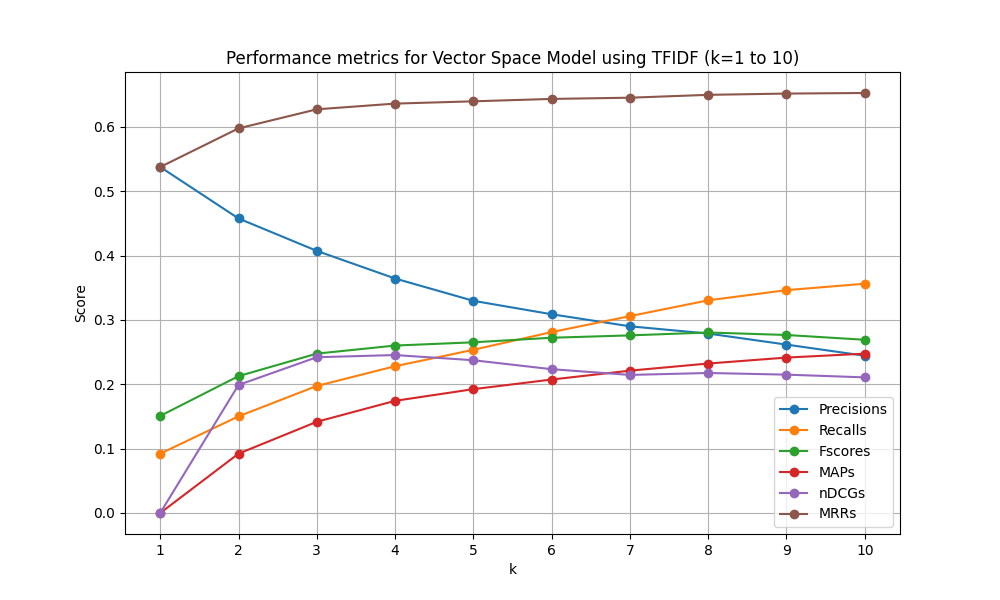
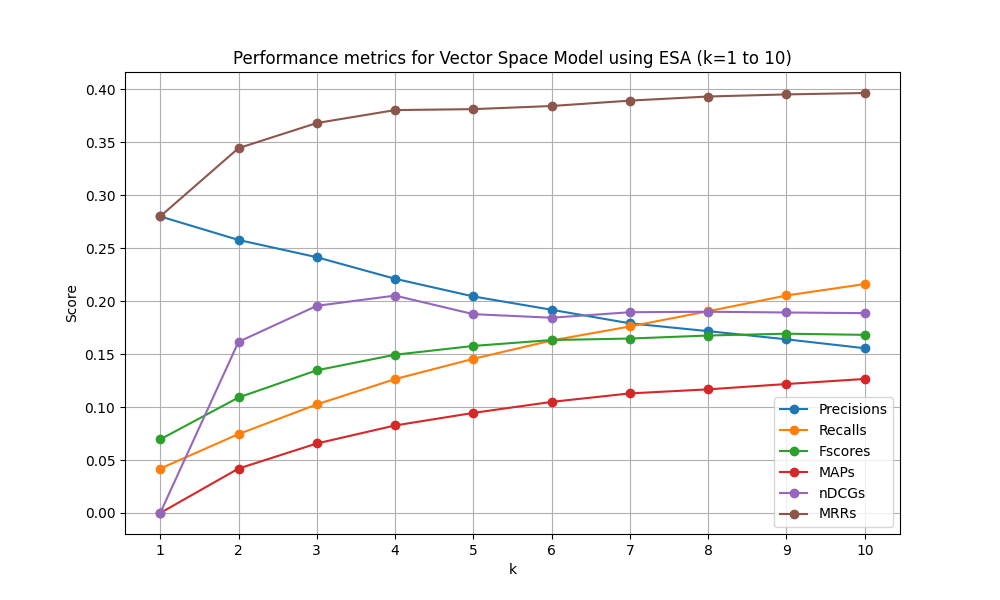
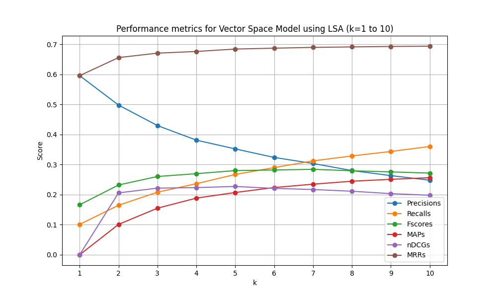
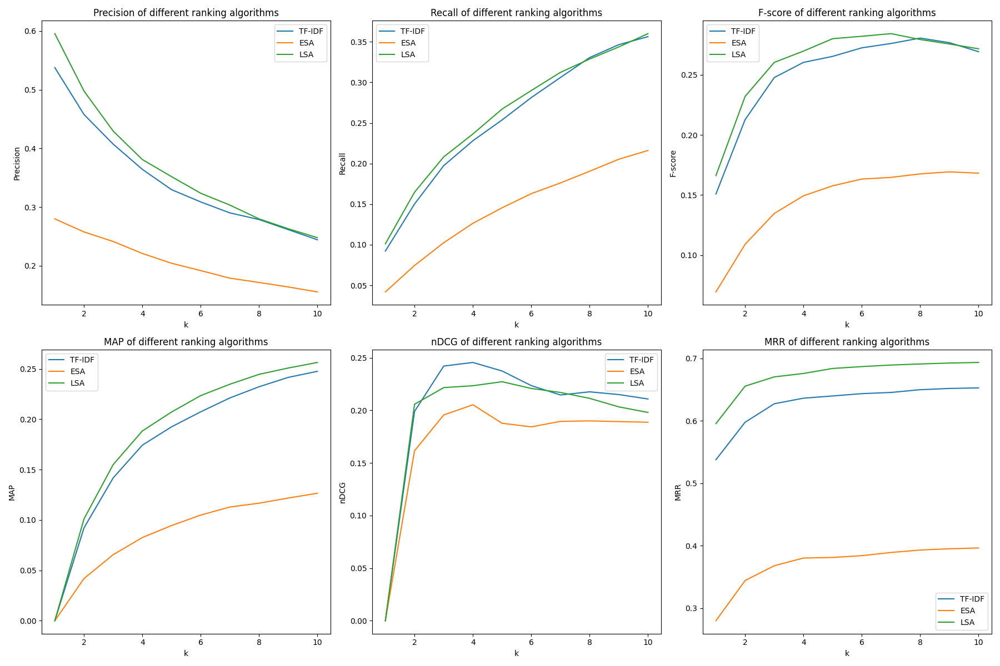

# Information Retrival Engine on Cranfield Dataset

This repository contains the course project for `CS6370 - Natural Language Processing` . The objeciev is to build and evalauate a **Search Engine** using the **Cranfield dataset**. We are experimentting different ranking **(LSA,ESA etc)** along side with some **Deep Learning Methods** and  comparing the **retrival** performance

## Team Members

|Name |Roll No|
|----------|-------|
|Krishna Chaitanya Gorle    |DA25M011|
|Mohammed Fiyas  |DA25M018|
|Ganesh Mula     |DA25M019 |
|Pranav Rao    |DA25M022 |
|Harendra    |DA25M028 |

## Metrics Implemented

1. Mean Precision
2. Mean Recall
3. Mean F1 Score
4. Mean nDCG
5. Mean Average Precision
6. Mean Reciprocal Rank

## Performance of Different Ranking Methods

### 1. TF-IDF

|Precisions|Recalls|Fscores|MAPs   |nDCGs  |MRRs  |
|----------|-------|-------|-------|-------|------|
|0.5378    |0.0922 |0.1509 |0.0    |0.0    |0.5378|
|0.4578    |0.1502 |0.2127 |0.0922 |0.199  |0.5978|
|0.4074    |0.1974 |0.2477 |0.1418 |0.2421 |0.6274|
|0.3644    |0.2281 |0.2603 |0.1743 |0.2455 |0.6363|
|0.3298    |0.2537 |0.2653 |0.1925 |0.2374 |0.6399|
|0.3089    |0.2812 |0.2724 |0.2074 |0.2235 |0.6436|
|0.2902    |0.306  |0.276  |0.2212 |0.2146 |0.6455|
|0.2789    |0.3305 |0.2805 |0.2323 |0.2176 |0.6499|
|0.2617    |0.3464 |0.2767 |0.2416 |0.215  |0.6519|
|0.2444    |0.3563 |0.2692 |0.2476 |0.2108 |0.6528|

### 2. ESA

|Precisions|Recalls|Fscores|MAPs  |nDCGs |MRRs  |
|----------|-------|-------|------|------|------|
|0.28      |0.0419 |0.0695 |0.0   |0.0   |0.28  |
|0.2578    |0.0745 |0.1091 |0.0419|0.1616|0.3444|
|0.2415    |0.1025 |0.1347 |0.0656|0.1956|0.3681|
|0.2211    |0.1264 |0.1494 |0.0826|0.2053|0.3804|
|0.2044    |0.1455 |0.1577 |0.0945|0.1877|0.3813|
|0.1919    |0.1629 |0.1633 |0.1049|0.1843|0.3842|
|0.179     |0.1761 |0.1647 |0.1129|0.1895|0.3893|
|0.1717    |0.1905 |0.1676 |0.1167|0.19  |0.3932|
|0.164     |0.2053 |0.1693 |0.1218|0.1893|0.3952|
|0.1556    |0.2161 |0.1682 |0.1266|0.1887|0.3965|

### 3. LSA

|Precisions|Recalls|Fscores|MAPs  |nDCGs |MRRs  |
|----------|-------|-------|------|------|------|
|0.5956    |0.1011 |0.1662 |0.0   |0.0   |0.5956|
|0.4978    |0.1647 |0.232  |0.1011|0.2058|0.6556|
|0.4296    |0.2082 |0.2603 |0.155 |0.2216|0.6704|
|0.3811    |0.2364 |0.2697 |0.1884|0.2234|0.6759|
|0.352     |0.2671 |0.28   |0.2072|0.2272|0.6839|
|0.3237    |0.2899 |0.282  |0.2235|0.2208|0.6869|
|0.3035    |0.3123 |0.2842 |0.2348|0.217 |0.6894|
|0.28      |0.3287 |0.2793 |0.2446|0.2114|0.6911|
|0.2632    |0.3436 |0.2756 |0.2509|0.2033|0.6926|
|0.248     |0.36   |0.2716 |0.2564|0.198 |0.6935|

### Plots

### 1 TF-IDF Performance

### 2 ESA Performance

### 3 LSA Performance

### 4 Final Comparision

